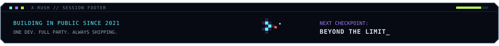

<p align="center">
  <picture>
    <source media="(max-width: 640px)" srcset="assets/banner-mobile.svg" />
    
  </picture>
</p>

<p align="center">
  <code>STATUS: ONLINE</code> · <code>ROLE: TOOLSMITH FOR AI AGENTS</code> · <code>EXCEPTION: INTENTIONAL</code>
</p>

---

## 01 / WHOAMI

```bash
rush@github:~ $ whoami
Rushing Lee — Toolsmith for AI Agents
一个人，一支战队：引擎 · 工作流 · 应用 · 内容

rush@github:~ $ cat mission.txt
one developer, shipping like a team
build engines, workflows and apps that actually ship.

rush@github:~ $ echo "$EXCEPTION"
我是 x-rush，一个总想突破界限、跳出常规的人——去做那个「下标越界」的异常。
"Always pushing past boundaries, breaking out of convention —
 be the out-of-bounds exception." — x-rush

rush@github:~ $ uptime
[##########] building in public since 2021 ...
```

---

## 02 / PARTY MEMBERS

> **ONE PERSON. FOUR CLASSES. FULL PARTY.**
> 不是一个人硬撑，而是让引擎、工作流、应用与内容协同作战。

| SLOT | CLASS | LOADOUT | MISSION |
|---|---|---|---|
| `01` | **ENGINEER** | image-forge · music-forge · video-forge | 锻造多通道生成引擎 |
| `02` | **ARCHITECT** | app-dev-workflow | 设计让智能体真正交付的工作流 |
| `03` | **BUILDER** | draftdesk · rednote-vibe-tools · dishes-menu | 构建可用、好看的创意应用 |
| `04` | **SCOUT** | skills & tutorials, shipped in public | 探索方法，并公开分享技能与教程 |

---

## 03 / ACTIVE QUESTS

> **NOT JUST TOOLS — THE WORKFLOWS THAT MAKE AGENTS ACTUALLY SHIP.**
> 不止造工具，还造让智能体真正「交付」的工作流。

<table>
  <tr>
    <th>Quest · 任务</th>
    <th>Mission · 说明</th>
    <th>Status</th>
  </tr>
  <tr>
    <td> <a href="https://github.com/x-rush/draftdesk"><b>draftdesk</b></a></td>
    <td>Self-hosted AI research &amp; editorial workbench with evidence-backed topics, trends and ideas<br>自托管 AI 研究与编辑工作台：有据可查的选题、趋势与灵感</td>
    <td><code>Q-01</code></td>
  </tr>
  <tr>
    <td> <a href="https://github.com/x-rush/app-dev-workflow"><b>app-dev-workflow</b></a></td>
    <td>Six-stage app development workflow for AI coding agents (requirement → prototype → build → test → architect)<br>面向 AI 编程智能体的六阶段应用开发工作流技能</td>
    <td><code>Q-02</code></td>
  </tr>
  <tr>
    <td> <a href="https://github.com/x-rush/photo-retouch"><b>photo-retouch</b></a></td>
    <td>Professional portrait retouching methodology — exhaustive analysis, single-shot generation, identity-anchor verification<br>专业人像修图方法论：穷尽分析、一次成图、身份锚点校验</td>
    <td><code>Q-03</code></td>
  </tr>
</table>

---

## 04 / FORGE SYSTEM

> **MULTI-CHANNEL GENERATION ENGINES — ONE JSON REGISTRY, ZERO DRAMA.**
> 可直接接入编程智能体的多通道生成引擎：一个 JSON 注册表，零依赖、零折腾。

```text
IMAGE FORGE ─┐
MUSIC FORGE ─┼──> AGENT CREATIVE ENGINE
VIDEO FORGE ─┘
```

<table>
  <tr>
    <th>Core · 核心</th>
    <th>Capability · 功能</th>
    <th>Channels · 通道</th>
  </tr>
  <tr>
    <td> <a href="https://github.com/x-rush/image-forge"><b>image-forge</b></a></td>
    <td>Multi-channel AI image generation engine — model registry, edit-endpoint routing &amp; spend budgeting<br>多通道 AI 生图引擎：模型注册表、编辑路由、预算管控</td>
    <td>fal.ai · Replicate</td>
  </tr>
  <tr>
    <td> <a href="https://github.com/x-rush/music-forge"><b>music-forge</b></a></td>
    <td>Multi-channel AI music engine, model routing via one JSON registry, zero dependencies<br>多通道 AI 音乐引擎：单一注册表路由模型，零依赖</td>
    <td>Suno · Mureka</td>
  </tr>
  <tr>
    <td> <a href="https://github.com/x-rush/video-forge"><b>video-forge</b></a></td>
    <td>Multi-channel AI video engine — generation, voiceover &amp; ffmpeg assembly<br>多通道 AI 视频引擎：生成、配音与成片组装</td>
    <td>Wan3.0 · Seedance · ffmpeg</td>
  </tr>
</table>

---

## 05 / INVENTORY

> **`39 MODULES INSTALLED // FULL PARTY LOADOUT // ALL SYSTEMS READY`**
> 完整装备库，全模块展开。

<p><b>[01] LANG.SYS [07] — Languages · 语言</b></p>
<p>
  
  
  
  
  
  
  
</p>

<p><b>[02] FRONTEND.SYS [08] — Frontend · 前端</b></p>
<p>
  
  
  
  
  
  
  
  
</p>

<p><b>[03] BACKEND.SYS [05] — Backend Frameworks · 后端框架</b></p>
<p>
  
  
  
  
  
</p>

<p><b>[04] DATABASE.SYS [05] — Databases · 数据库</b></p>
<p>
  
  
  
  
  
</p>

<p><b>[05] DEVOPS.SYS [09] — DevOps &amp; Cloud · 运维与云</b></p>
<p>
  
  
  
  
  
  
  
  
  
</p>

<p><b>[06] AI_MEDIA.SYS [05] — AI &amp; Media Engineering · AI 与多媒体工程</b></p>
<p>
  
  
  
  
  
</p>

---

## 06 / SYSTEM METRICS

<p align="center">
  <picture>
    <source media="(prefers-color-scheme: dark)" srcset="https://github-profile-summary-cards.vercel.app/api/cards/stats?username=x-rush&amp;theme=tokyonight" />
    
  </picture>
  <picture>
    <source media="(prefers-color-scheme: dark)" srcset="https://github-profile-summary-cards.vercel.app/api/cards/most-commit-language?username=x-rush&amp;theme=tokyonight" />
    
  </picture>
</p>

---

## 07 / CURRENTLY

```bash
rush@github:~ $ ps aux | grep now
venture  01  multi-platform content matrix       # 多内容自媒体矩阵
venture  02  AI SaaS sites --going-global        # AI SaaS 独立站出海
venture  03  creative apps portfolio             # 创意应用矩阵
venture  04  cross-border e-commerce             # 跨境电商
```

---

<p align="center">
  <a href="https://github.com/x-rush?tab=follow">
    
  </a>
</p>

<p align="center">
  <picture>
    <source media="(max-width: 640px)" srcset="assets/footer-mobile.svg" />
    
  </picture>
</p>
