<p align="center">
  
</p>

<p align="center">
  <a href="https://readme-typing-svg.demolab.com">
    
  </a>
</p>

---

## ⚡ `whoami`

```bash
rush@github:~ $ whoami
Rushing Lee · one developer, shipping like a team
#     一个人，一支战队的产出：引擎 · 工作流 · 应用 · 内容

rush@github:~ $ cat team.manifest
engines     ->  image-forge · music-forge · video-forge
workflows   ->  app-dev-workflow · claude-code-autopilot
apps        ->  draftdesk · rednote-vibe-tools · dishes-menu
content     ->  skills & tutorials, shipped in public
#     引擎 · 工作流 · 应用 · 内容 —— 四条产品线，一人全栈

rush@github:~ $ echo "$MOTTO"
吾辈为学，当从心髓入微处用力，自然笃实光辉。
#     "Apply effort at the subtlest depths of the mind, and solidity & brilliance follow."
#     —— 曾国藩 Zeng Guofan

rush@github:~ $ uptime
[##########] building in public since 2021 ...
```

---

## 🔥 `ls ~/forges/` — The Forge Series · 锻造系列

> Multi-channel generation engines that plug straight into coding agents — one JSON registry, zero drama.
> 可直接接入编程智能体的多通道生成引擎 —— 一个 JSON 注册表，零依赖、零折腾。

| Engine 引擎 | What it does 功能 | Powered by 通道 |
| --- | --- | --- |
| ⚒️ [**image-forge**](https://github.com/x-rush/image-forge) | Multi-channel AI image generation engine — model registry, edit-endpoint routing & spend budgeting<br>多通道 AI 生图引擎：模型注册表、编辑路由、预算管控 | fal.ai · Replicate |
| 🎵 [**music-forge**](https://github.com/x-rush/music-forge) | Multi-channel AI music engine, model routing via one JSON registry, zero dependencies<br>多通道 AI 音乐引擎：单一注册表路由模型，零依赖 | Suno · Mureka |
| 🎬 [**video-forge**](https://github.com/x-rush/video-forge) | Multi-channel AI video engine — generation, voiceover & ffmpeg assembly<br>多通道 AI 视频引擎：生成、配音与成片组装 | Wan3.0 · Seedance · ffmpeg |

---

## 🛠️ `ls ~/builds/` — Workflows & Apps · 工作流与应用

> Not just tools — the workflows that make agents actually ship.
> 不止造工具，还造让智能体真正「交付」的工作流。

| Project 项目 | What it is 说明 |
| --- | --- |
| 🧭 [**app-dev-workflow**](https://github.com/x-rush/app-dev-workflow) | Six-stage app development workflow for AI coding agents (requirement → prototype → build → test → architect)<br>面向 AI 编程智能体的六阶段应用开发工作流技能 |
| 📝 [**draftdesk**](https://github.com/x-rush/draftdesk) | Self-hosted AI research & editorial workbench with evidence-backed topics, trends and ideas<br>自托管 AI 研究与编辑工作台：有据可查的选题、趋势与灵感 |
| 🤖 [**claude-code-autopilot**](https://github.com/x-rush/claude-code-autopilot) | Fully unattended project execution — deep requirement discussion, smart planning, continuous autonomous delivery<br>完全无人值守的项目执行系统：深度需求讨论 + 智能计划 + 连续自主交付 |
| 📸 [**photo-retouch**](https://github.com/x-rush/photo-retouch) | Professional portrait retouching methodology — exhaustive analysis, single-shot generation, identity-anchor verification<br>专业人像修图方法论：穷尽分析、一次成图、身份锚点校验 |

---

## 🧰 `cat toolbox.json` — Toolbox · 工具箱

<p align="left"><b>💻 Languages · 语言</b></p>
<p align="left">
  
  
  
  
  
  
</p>

<p align="left"><b>🌐 Frontend · 前端</b></p>
<p align="left">
  
  
  
  
</p>

<p align="left"><b>⚙️ Backend Frameworks · 后端框架</b></p>
<p align="left">
  
  
  
  
  
</p>

<p align="left"><b>🗄️ Databases · 数据库</b></p>
<p align="left">
  
  
  
</p>

<p align="left"><b>🛠️ DevOps &amp; Cloud · 运维与云</b></p>
<p align="left">
  
  
  
  
  
  
  
</p>

<p align="left"><b>🧠 AI &amp; Media Engineering · AI 与多媒体工程</b></p>
<p align="left">
  
  
  
  
  
</p>

---

## 📊 `tail -f stats.log`

<p align="center">
  <picture>
    <source media="(prefers-color-scheme: dark)" srcset="https://github-readme-stats.vercel.app/api?username=x-rush&show_icons=true&hide_border=true&bg_color=0d1117&title_color=FF6B35&icon_color=FFD23F&text_color=c9d1d9&include_all_commits=true&count_private=true" />
    
  </picture>
  <picture>
    <source media="(prefers-color-scheme: dark)" srcset="https://github-readme-stats.vercel.app/api/top-langs/?username=x-rush&layout=compact&hide_border=true&bg_color=0d1117&title_color=FF6B35&text_color=c9d1d9&langs_count=8" />
    
  </picture>
</p>

---

## 🌱 `ps aux | grep now` — Currently · 正在进行

```bash
rush@github:~ $ ps aux | grep now
forge   01  teaching video-forge to transcribe — ASR → SRT subtitle pipeline
#         正在教 video-forge 听懂视频：语音识别 → 字幕管线
forge   02  iterating app-dev-workflow, shipping v0.2.x
#         迭代 app-dev-workflow 工作流技能
forge   03  building in public, one commit at a time
#         持续公开构建，一次一个 commit
```

---

<p align="center">
  <a href="https://github.com/x-rush?tab=follow">
    
  </a>
</p>

<p align="center">
  <picture>
    
  </picture>
</p>
